# Eddy Demoulin

<h3>Développeur logiciel / full-stack junior orienté produit - Nancy, France</h3>
<h4>Je développe des applications web et approfondis leur déploiement, leur automatisation et leur exploitation sous Linux.</h4>

## Tech stack

**Languages**

&nbsp;

**Frontend**

**Databases**

**DevOps**

&nbsp;

  <picture>
    <source media="(prefers-color-scheme: dark)" srcset="bonsai/bonsai-dark.svg">
    
  </picture>

## Projets

- **[LineupControl](https://www.lineupcontrol.com/)** - Application de vote en direct pour choisir le prochain genre d'un set DJ, développée avec Next.js et Supabase.
- **[DJ Kriss Event](https://www.dj-kriss-event.fr/)** - Conception et développement d'un site pour une activité de DJ et d'animation événementielle: première version en 2021, puis refonte en 2026 avec React, PHP et SQL.
- **Homelab** - pratique de Linux, Docker, Ansible et des sauvegardes/restaurations sur mon infrastructure personnelle. Contraintes d'open source, config-as-code, reversibilité, et mise en place de sécurités contre un modèle de menace complet: intrusion, attaque ciblé, accés physique, fournisseurs.

Les sources de ces projets restent privées. Les dépôts M-Motors ([front-end](https://github.com/EddyDem/m-motors-frontend) et [back-end](https://github.com/EddyDem/m-motors-backend)) sont des travaux scolaires conservés comme références historiques.

  

  <picture>
    
  </picture>

